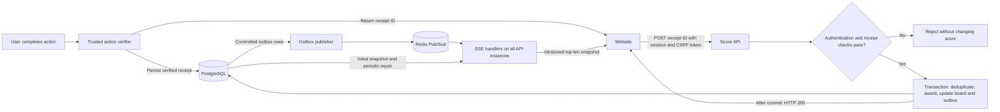
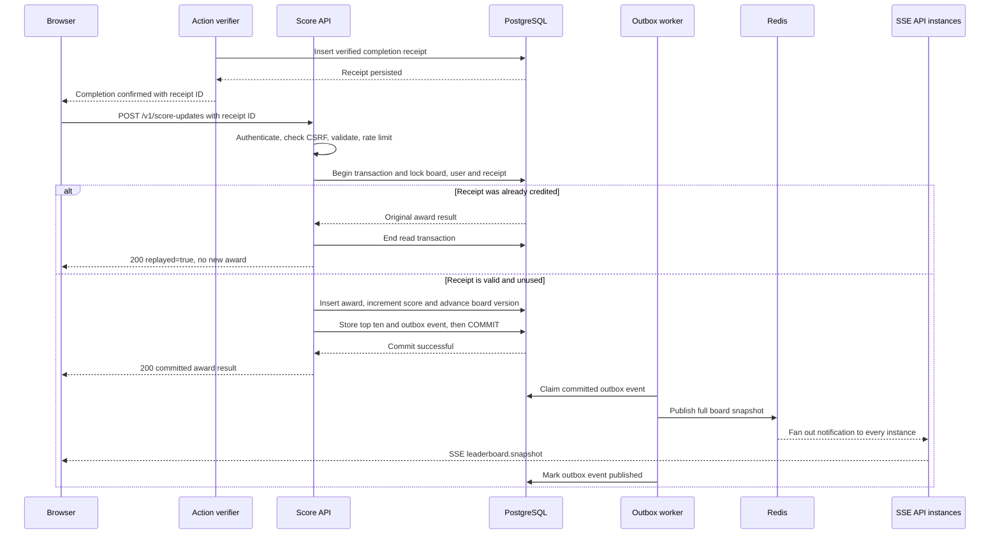

# Problem 6: Live Scoreboard Module Specification

**Deliverable:** a specification for the backend engineering team. This document proposes a new module; it does not add scoreboard endpoints to the Problem 5 task API.

## Requirements

1. Show the ten users with the highest scores on a website.
2. Update the scoreboard live.
3. Increase a user's score after they complete an action; the action itself is outside this module's scope.
4. Accept an API call dispatched after action completion.
5. Prevent unauthorized score increases.

## Assumptions and decisions

| Topic | Initial decision |
| --- | --- |
| Board scope | One global, lifetime scoreboard |
| Ranking | Score descending, then user UUID ascending; at most ten rows with ranks 1–10 |
| Eligible rows | Users with at least one awarded point; fewer than ten users means fewer rows |
| Starting score | Zero; all accepted rewards are positive integers |
| Reward amount | Chosen by an immutable, versioned backend policy for the action type |
| Identity | Existing user accounts and same-origin, cookie-based authenticated sessions |
| Read access | Both snapshot and live stream require authentication |
| Live protocol | Server-Sent Events (SSE); updates are full top-ten snapshots |
| Correctness | Every verified action is credited at most once, including retries and concurrent requests |
| Proposed service target | At 25 new awards/second and 1,000 concurrent viewers, commit-to-display latency p95 <= 1 second in healthy operation |

The load and latency figures are proposed acceptance targets, not measured capacity. The team must validate them before release. Seasons, score decreases, account/profile editing, and moderation removal are future extensions. Initial snapshots contain immutable public handles rather than email addresses or private profile data. Existing awarded scores remain on the board if an account is later suspended; future awards and access are blocked. Product should confirm this policy.

## Trust boundary: prove the action was completed

Authentication proves who is calling. It does not prove that the caller completed an action. A browser-provided `completed: true`, score delta, timestamp, or secret embedded in JavaScript is insufficient evidence.

The action-owning backend must verify completion and create a **completion receipt** in PostgreSQL before notifying the browser. A receipt identifies one completed action instance, its user, and the applicable reward-policy version. The action-owning backend decides how completion is verified; this is the integration contract for the action that the prompt leaves unspecified.

Receipt issuance requirements:

- Only an authenticated internal action verifier may insert receipts. The browser and Score API database role cannot mint or edit them.
- The verifier derives the subject from its trusted action/session context, verifies completion, and selects an allowed policy version. It must not accept a client assertion of success as proof.
- `(issuer, action_instance_id)` is unique, so retrying the verifier cannot mint multiple receipts for one action.
- Receipt UUIDs are generated by the backend and bound to one user. Their unpredictability supplements ownership checks; it does not replace them.
- Receipt fields are immutable except `revoked_at`. Unredeemed receipts expire ten minutes after completion, using database time. This is an explicit initial policy to confirm with product.
- Receipts are visible to the Score API before the browser receives their IDs. If the action runs in another service, replicate a verified completion through an authenticated internal channel and acknowledge receipt persistence before notifying the browser.

**Dependency:** without a trusted way to verify action completion, requirement 5 cannot be satisfied by this module alone. The action-owning team must implement the verifier before scoring is enabled.

## Components and execution flow

The module runs within the API service using TypeScript/Express. PostgreSQL stores scores, the award ledger, the current board, and an outbox. Redis Pub/Sub distributes committed board snapshots to every API instance with connected viewers. Redis is a notification transport; it is not the authority for scores.





SSE suits this requirement because the live channel carries server-to-browser updates. The score mutation remains a normal HTTP request. SSE framing and automatic reconnection use the browser's [EventSource protocol](https://html.spec.whatwg.org/multipage/server-sent-events.html).

## API contracts

All paths are versioned. JSON requests and responses use UTF-8. Scores and board versions are decimal **strings** backed by PostgreSQL `BIGINT`; clients must compare versions numerically (for example with `BigInt`), not lexicographically. Ranks are JSON numbers. Unknown request fields are rejected.

### POST /v1/score-updates

Requires an active session, `Content-Type: application/json`, an allowed `Origin`, and a valid `X-CSRF-Token`. Request bodies are limited to 1 KB.

```json
{ "actionReceiptId": "1b823faa-6f9b-405f-b99d-2b6e931f022a" }
```

The body contains exactly one UUID field. Do not accept `userId`, `delta`, `score`, or action-completion assertions. The session determines the user. The receipt determines the action and policy. The policy determines the positive reward.

Successful first submission returns `200 OK` **only after the database commits**:

```json
{
  "awardId": "fc65caf8-89cb-4910-aecd-64d2873b77fc",
  "actionReceiptId": "1b823faa-6f9b-405f-b99d-2b6e931f022a",
  "delta": "10",
  "scoreAfter": "120",
  "leaderboardVersion": "42",
  "replayed": false
}
```

The receipt ID is the durable idempotency key. A repeat submission by the same user returns `200` with the original stored award fields and `replayed: true`, without changing the score, version, or outbox. `scoreAfter` describes the score immediately after that award, not necessarily the user's latest score. A duplicate remains replayable after receipt expiry; account authorization and ownership still apply.

| Status | Code | Meaning |
| --- | --- | --- |
| `400` | `INVALID_REQUEST` | Missing/invalid UUID, unknown field, or malformed JSON |
| `401` | `UNAUTHENTICATED` | Missing or expired session |
| `403` | `FORBIDDEN` | Inactive account, disallowed origin, or invalid CSRF token |
| `404` | `RECEIPT_NOT_FOUND` | Receipt does not exist or belongs to another user |
| `409` | `RECEIPT_REVOKED` | Unused receipt was revoked |
| `410` | `RECEIPT_EXPIRED` | Unused receipt expired |
| `413` / `415` | `INVALID_BODY` | Body too large / unsupported content type |
| `422` | `SCORE_LIMIT_EXCEEDED` | Award would overflow signed 64-bit score range |
| `429` | `RATE_LIMITED` | Per-user or IP limit exceeded; include `Retry-After` |
| `503` | `TEMPORARILY_UNAVAILABLE` | Database/verifier dependency unavailable or transaction retry budget exhausted |

An impossible stored policy or other unexpected internal failure returns `500 INTERNAL_ERROR` and alerts the team. Failure responses expose no SQL or infrastructure details. Example shape:

```json
{ "error": { "code": "RECEIPT_EXPIRED", "message": "The completion receipt has expired." }, "requestId": "req-123" }
```

For a network timeout or `503`, retry with the same receipt ID using exponential backoff and jitter. A response lost after commit must not cause a second award. Clients must not retry permanent 4xx failures, except waiting for the indicated delay after `429`.

### GET /v1/leaderboard

Return the latest committed `board_state.snapshot` from the PostgreSQL primary with `200 OK` and `Cache-Control: no-store`. The version and entries come from the same stored document, never from separate queries or an asynchronous replica.

```json
{
  "version": "42",
  "updatedAt": "2026-10-19T08:00:00.000Z",
  "entries": [
    { "rank": 1, "userId": "b6c0d447-aebb-4829-88af-55a2b2ffd1ef", "handle": "player_one", "score": "120" }
  ]
}
```

The initial state is version `"0"` with `entries: []`. Every accepted new award advances the version, even when the top-ten entries remain the same. This endpoint is also the fallback for browsers that cannot maintain an SSE connection.

### GET /v1/leaderboard/events

Authenticate before starting the response. Use the same-origin session cookie; do not put access tokens in URLs. Return:

```text
Content-Type: text/event-stream
Cache-Control: no-cache, no-transform
X-Accel-Buffering: no
```

Disable proxy response buffering and stream compression buffering. Flush headers and each complete event. Proxy idle timeout must exceed the heartbeat interval.

```text
retry: 3000
id: 42
event: leaderboard.snapshot
data: {"version":"42","updatedAt":"2026-10-19T08:00:00.000Z","entries":[{"rank":1,"userId":"b6c0d447-aebb-4829-88af-55a2b2ffd1ef","handle":"player_one","score":"120"}]}

```

Each event ends with a blank line. Send `: heartbeat` followed by a blank line every 15 seconds. Event IDs equal the included board version. This stream conveys **current state**, so it need not replay every intermediate score change.

Connection and recovery algorithm:

1. Register the connection with the API instance's fan-out dispatcher before reading the initial board snapshot. If the Redis subscription is unavailable, enter degraded polling mode immediately.
2. Buffer/coalesce arriving notifications while reading `board_state` from the primary. Send the highest-version snapshot among the initial read and buffered notifications, then activate live delivery. Serialize writes per connection so an older initial snapshot cannot overwrite a newer update.
3. Keep only the latest pending snapshot per connection, flushing at most once every 250 ms. Send versions strictly greater than the last one sent on that connection. Disconnect clients with more than 64 KB of buffered output or ten seconds of blocked writes.
4. On reconnect, accept `Last-Event-ID` as a nonnegative decimal string within `BIGINT` range. It is a hint, not an authorization credential or replay requirement. Always send the latest full snapshot first, even if it has the same version. Invalid or future IDs do not block resynchronization. The browser retains only snapshots newer than its displayed version, except that a first snapshot initializes an empty page.
5. Every API instance with viewers reads `board_state` from the primary every five seconds with jitter and fans out any newer version. Use one shared read per instance, not one per viewer. This repairs missed Pub/Sub messages, including the case where the final notification was lost and no later event arrives.
6. Mark the UI disconnected/stale on stream failure. Retry network disconnects and use `GET /v1/leaderboard` every five seconds as a temporary fallback. On authentication failure, refresh the session or request login instead of retrying indefinitely. Native `EventSource` does not expose HTTP error bodies; the client can check the authenticated snapshot endpoint to distinguish session failure.

Limit initial streams to three per user and ten per IP, enforced across instances. Recheck session/account validity every 60 seconds and close at session expiry. On revocation, send `session.expired` where possible, then close; authorization failures on the next connection return `401`/`403` before streaming. Remove listeners, timers, and connection counters on disconnect. The client must close its `EventSource` on logout.

## Persistent data model

Use PostgreSQL migrations. User IDs reference the existing account table. All timestamps are `TIMESTAMPTZ` in UTC; use database time for receipt expiry. `BIGINT` fields must be handled without conversion to JavaScript `number`.

| Table | Required fields and constraints |
| --- | --- |
| `reward_policies` | `action_type`, `policy_version` composite primary key; `reward BIGINT CHECK (reward > 0)`; immutable published rows |
| `action_receipts` | `id UUID PK`; `user_id` FK; `issuer`; `action_instance_id`; `action_type`, `policy_version` FK to policy; `completed_at`, `expires_at`, nullable `revoked_at`; unique `(issuer, action_instance_id)`; expiry greater than completion time |
| `user_scores` | `user_id UUID PK/FK`; `score BIGINT NOT NULL DEFAULT 0 CHECK (score >= 0)`; `updated_at` |
| `score_awards` | `id UUID PK`; `receipt_id UUID UNIQUE NOT NULL` FK; `user_id` FK; `delta BIGINT CHECK (delta > 0)`; `score_after BIGINT`; `board_version BIGINT UNIQUE`; `created_at`; immutable award record |
| `board_state` | `id SMALLINT PK CHECK (id = 1)`; `version BIGINT NOT NULL CHECK (version >= 0)`; `snapshot JSONB NOT NULL`; `updated_at`; exactly one row initialized by migration |
| `score_outbox` | `id UUID PK`; `board_version BIGINT UNIQUE`; `payload JSONB` full snapshot; `created_at`; nullable `published_at`; `attempts`; `available_at`; nullable `lease_token`, `lease_until` |

Index `user_scores(score DESC, user_id ASC)` for ranking. Index `score_awards(user_id, created_at DESC)` for audit, and unprocessed outbox rows by `available_at, board_version` for worker claims. The unique receipt constraint is the final safeguard against duplicate awards, independent of application checks. Keep award/receipt deduplication records durably; do not delete them on a short request-cache TTL.

The ranking query joins `user_scores` to immutable public user handles, filters `score > 0`, orders by `score DESC, user_id ASC`, and takes `LIMIT 10`. Assign ranks 1 through the number of returned rows. Store this ordered result as a JSON snapshot with decimal-string scores and version. No Redis sorted-set ranking is required in the initial implementation.

Database privileges must separate responsibilities: the action verifier inserts receipts; the Score API reads policies/receipts and writes scores, awards, board state, and outbox; the publisher claims/acknowledges outbox rows and publishes notifications. The Score API must not update reward policies or insert completion receipts. Receipt revocation uses a restricted internal role and the same receipt-row lock as redemption.

## Award transaction and concurrency

Use PostgreSQL `READ COMMITTED` with explicit row locks. All score-changing writers must take the singleton board lock first. This serializes accepted awards and makes board versions follow commit order; a sequence number alone would not provide that guarantee. PostgreSQL documents the behavior of [row locks](https://www.postgresql.org/docs/current/explicit-locking.html) and [READ COMMITTED snapshots](https://www.postgresql.org/docs/current/transaction-iso.html).

Implementation algorithm:

```text
Before transaction:
  authenticate session; verify Origin and CSRF; validate UUID; apply rate limits

BEGIN (READ COMMITTED; lock timeout 1 second; statement timeout 2 seconds)
  SELECT board_state WHERE id = 1 FOR UPDATE
  SELECT account WHERE id = session.user_id FOR SHARE
    reject if missing or inactive
  SELECT action_receipt WHERE id = requested_id AND user_id = session.user_id FOR UPDATE
    reject as 404 if absent; verify trusted issuer for action type
  SELECT score_award WHERE receipt_id = requested_id
    if present: end transaction, return original award with replayed=true
  check revoked_at is null and expires_at > clock_timestamp()
  load immutable policy; derive delta (never use a client delta)
  INSERT user_score(user_id, 0) ON CONFLICT DO NOTHING
  UPDATE user_score SET score = score + delta, updated_at = database time
    reject and roll back on BIGINT overflow
  next_version = locked board_state.version + 1
  INSERT score_award(receipt_id, user_id, delta, score_after, next_version)
  SELECT top ten using the ranking index
  UPDATE board_state SET version = next_version, snapshot = complete snapshot
  INSERT score_outbox(board_version = next_version, payload = same snapshot)
COMMIT

Return committed award with replayed=false
```

Use parameterized SQL. Validate `BIGINT` limits before incrementing the score and board version; exhausting the board version is an operational fault that must stop writes and alert, never wrap around. All errors before commit roll back the score, award record, board snapshot, and outbox together. Do not call Redis or an external verifier while holding these locks.

Two calls for one receipt are serialized: the first commits the award; the second sees the committed ledger entry and returns it. Different receipts for the same user accumulate without lost updates. A revoked or expired unused receipt has no side effects. Receipt revocation and account deactivation must take their respective row locks, so an in-flight transaction has a defined winner.

Retry deadlocks or serialization failures at most three times with bounded jitter, staying within a five-second HTTP deadline. On a lock timeout or exhausted deadline return `503` with `Retry-After: 1`; the client may safely retry the receipt. Log unexpected constraint failures instead of presenting them as successful awards.

## Outbox publication and notification reliability

The outbox prevents a committed score from depending on a successful Redis publish in the request handler. Proposed initial publisher settings: poll every 100 ms, claim at most 100 rows, five-second leases, one-second Redis operation timeout.

1. In a short transaction, claim eligible unpublished rows with `FOR UPDATE SKIP LOCKED`. Set a fresh lease token, lease expiry, and increment attempts; commit the claim.
2. Outside the database transaction, publish each stored snapshot to `leaderboard.global`. The message includes its board version. Renew leases when necessary; never hold locks while waiting on Redis.
3. After a publish acknowledgement, set `published_at` only if the row's lease token still matches. A successful Redis command with zero subscribers is still acknowledged: later viewers read the primary snapshot.
4. On failure, clear/reschedule the lease with exponential backoff (100 ms up to 30 seconds). A worker crash leaves a lease that another worker can reclaim. Never delete an unpublished row because it exceeded a retry count; alert and keep retrying.
5. A crash after publishing but before acknowledgement can publish the same event twice. Workers can also publish out of order. API instances and browsers discard older/equal versions and use full snapshots, making those deliveries harmless.

This provides **at-least-once publication attempts**, not guaranteed delivery to every Pub/Sub subscriber. Redis Pub/Sub is [at-most-once delivery](https://redis.io/docs/latest/develop/pubsub/); disconnected subscribers can miss messages. The five-second primary snapshot repair is required for correctness of the displayed state. Redis outages must not roll back successfully committed awards.

After recovery, workers may collapse superseded full-snapshot notifications into the newest version to reduce load, but only as a later optimization with the same repair behavior. Initially publish every outbox row. Retain published outbox rows for seven days; retain award deduplication evidence for the lifetime of the board, with archived evidence still consulted if data is moved.

## Security and abuse controls

Apply authorization on every endpoint. Use TLS, a server-managed `Secure`, `HttpOnly`, `SameSite=Lax` session cookie, CSRF tokens and explicit same-origin checks for mutation requests. Do not allow wildcard credentialed CORS. Session validity must be checked server-side; logging a token or receipt ID in a public URL is prohibited. These controls follow the principles in [OWASP's REST security guidance](https://cheatsheetseries.owasp.org/cheatsheets/REST_Security_Cheat_Sheet.html).

| Attack or failure | Required control |
| --- | --- |
| User submits a larger delta or another user ID | Reject unknown body fields; derive subject and reward on the backend |
| User fabricates an action completion | Require a receipt issued after trusted verification |
| User steals another account's receipt | Bind receipt to the authenticated user; return indistinguishable `404` |
| User resubmits one receipt or sends requests concurrently | Durable unique receipt ledger plus transaction/locks |
| Verifier retries the same action | Unique `(issuer, action_instance_id)` at issuance |
| Cross-site browser causes score submission | Session cookie policy, Origin allowlist, and CSRF validation |
| SQL injection / stored HTML in handles | Parameterized queries; render handles as text in the browser |
| Flooding requests or streams | Shared per-user/IP limits, body limits, connection limits, bounded output queues |
| API or publisher process crashes | Atomic transaction, persistent ledger/outbox, lease recovery, client resync |

Initial HTTP limits are 30 score-update requests per minute per user (burst 10) and 120 per minute per IP (burst 30), using a shared token bucket. Failed and duplicate submissions count. Tune against legitimate action frequency and shared-network behavior. If the distributed limiter is unavailable, reject new mutation requests with `503`; use conservative local limits for read connections. Trusted completion receipts remain necessary even with rate limiting.

Audit each accepted award with user ID, receipt ID, issuer, policy version, delta, score after, board version, and request ID. Track rejected claims and unusual completion patterns. Keep credentials, session cookies, and CSRF tokens out of logs. A compromised trusted verifier can mint false completions; restrict its credentials and monitor issuance. Rate limiting does not solve this trust-boundary compromise.

## Failure behavior and operations

| Situation | Behavior |
| --- | --- |
| Receipt missing or trusted completion unavailable | Reject without a score change; the action service must not report receipt readiness prematurely |
| Database fails before commit | Roll back and return `503`; no provisional success or event |
| HTTP response lost after commit | Retry returns the stored award; score remains unchanged |
| Redis unavailable | Accept verified awards; outbox retries; connected instances repair from primary every five seconds |
| Subscriber misses final notification | Periodic primary read repairs it even with no further actions |
| Database read unavailable | New snapshot requests return `503`; streams send a `leaderboard.unavailable` control event where possible and close rather than send fabricated fresh data |
| Stream instance restarts | Browser reconnects to any healthy instance and receives the current full snapshot |
| Viewer is slow | Coalesce snapshots; disconnect on buffer/time limits; reconnect fetches latest state |

Metrics: award acceptance/rejection counts, duplicate rate, HTTP latency, board-lock wait, transaction failures, oldest unpublished outbox age, publish retries, active streams, dropped slow clients, repair reads, and commit-to-broadcast/display latency. Alert initially if the oldest unpublished row exceeds five seconds for one minute, or if the proposed latency/error targets fail. Monitor lock contention before raising traffic limits.

Provide API readiness checks for the database/schema and publisher health separately. Redis degradation should be reported without marking the score-write path unusable. During shutdown, stop accepting mutations, finish in-flight transactions, notify/close SSE clients, and stop workers without marking unsent rows published. Back up PostgreSQL and test restore procedures. After a restore, explicitly reset browser stream state (for example by changing a deployment/board epoch) if versions may have moved backward.

## Acceptance tests for the implementation team

These are required future tests, not tests already executed in this repository. Use real PostgreSQL and Redis for transactional and cross-instance cases.

| Scenario | Expected outcome |
| --- | --- |
| Submit valid receipt for an active user | One award, correct score increase, one version advance, committed outbox row |
| Send forged receipt, user ID, delta, or unauthenticated request | No score, award, board, or outbox change |
| Submit a receipt belonging to someone else | `404`; no information disclosure or score change |
| Send 100 concurrent requests for one receipt | Exactly one award; successful duplicates return the original award |
| Submit two different receipts for the same user concurrently | Final score includes both rewards; versions are distinct and ordered |
| Repeat a committed receipt after expiry or after another award | Original award response; no extra credit; scoreAfter retains original meaning |
| Submit revoked/expired unused receipt | Reject; no partial database effects |
| Crash before commit / after commit before HTTP response | Full rollback / safe replay of committed award |
| Publish succeeds, worker crashes before acknowledgement | Duplicate notification does not regress or double-count the board |
| Two workers publish versions in reverse order | Browser retains the greater numeric version |
| Update commits between subscription registration and initial read | Client receives that snapshot or a newer one; no initial-read race |
| Drop the last Pub/Sub message, with no subsequent actions | Viewer converges via periodic repair within ten seconds while dependencies are healthy |
| Lose Redis for one minute, then restore it | No lost scores; repair keeps viewers current; outbox eventually drains |
| Connect through two API instances and restart one | Both receive updates; disconnected viewers reconnect and resynchronize |
| More/fewer than ten scored users and tied scores | At most ten rows, deterministic ties, correct ranks; empty board supported |
| Revoke session or exhaust request/connection limits | Access ends within the specified recheck window; correct `401`/`403`/`429` behavior |
| Fill a slow client's output buffer | Bounded memory use; client disconnected; other viewers unaffected |
| Attempt a score overflow | `422`; score, ledger, board, and outbox remain unchanged |
| Sustained proposed load for 30 minutes | Meet agreed latency/error targets with no growing outbox backlog or memory leak |

## Improvements and implementation order

The singleton board lock deliberately favors simple, auditable ordering for an initial global board. It serializes all awards and is the first likely write-throughput bottleneck. Measure lock wait under the proposed load before release; do not assume that adding API instances raises this limit.

For greater scale, partition by season/competition so each board has its own lock and version. If one board outgrows this approach, move ranking to an ordered asynchronous projector and explicitly revise consistency and acknowledgement semantics. Redis sorted sets can accelerate ranking, but preserve a durable award ledger and address large-integer precision and deterministic ties before adopting them.

Other improvements: authenticated server-to-server automatic redemption for users who close the page before claiming; a product-approved offline/receipt-expiry policy; moderator tooling with immutable compensating ledger entries; risk scoring for automated abuse; and a durable event transport if consumers must receive every award rather than only the latest board state.

Implementation order:

1. Agree on the completion-verifier integration, reward policies, identity/session service, expiry, and moderation behavior.
2. Add migrations, restricted database roles, transactional award service, and concurrency/security tests.
3. Implement the mutation and authoritative snapshot endpoints with the specified errors and limits.
4. Implement outbox publication, cross-instance SSE fan-out, periodic repair, and browser version handling.
5. Configure proxy streaming, metrics, graceful shutdown, restore procedures, and run failure/load tests before rollout.
